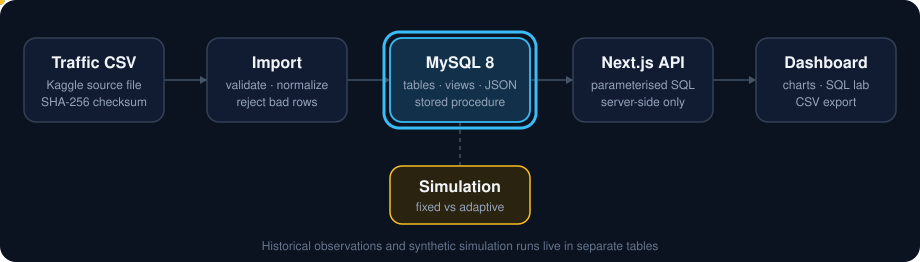
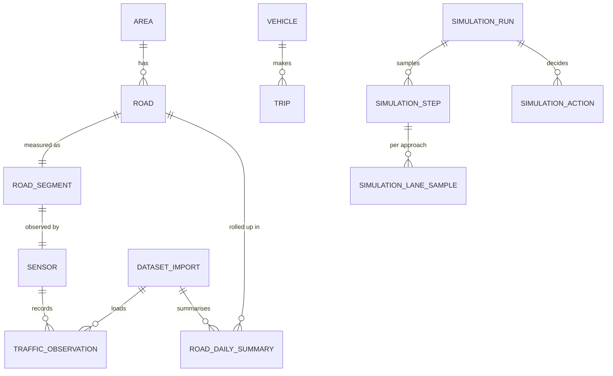
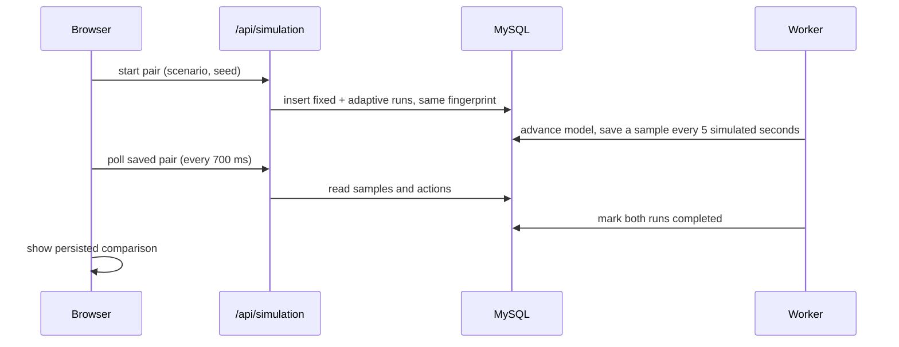

<div align="center">

# Urban Mobility

**An Advanced SQL project: a normalized MySQL traffic database, a dashboard on top of it, and a signal simulation that compares fixed and adaptive timing.**




</div>

## Overview

Raw traffic readings arrive as a flat CSV. This project loads them into a **normalized MySQL 8 schema**, exposes them through **server-side parameterised SQL**, and lets you explore them in a web dashboard that doubles as a SQL teaching tool: every screen shows the query behind it.

A second, clearly separate part simulates a four-way junction under **fixed** and **adaptive** signal control. Both controllers receive identical, seeded demand, and every step is stored in MySQL so the comparison is itself a SQL result.

| Area | What it does |
| --- | --- |
| **Overview** | Headline numbers, insight cards (busiest and most congested road, peak time block, biggest speed gain and drop), volume and congestion charts. |
| **Explore** | Four tabs: time and weather patterns; a road × time-block congestion heatmap with area groupings; **operations** (capacity, travel-time index, signal compliance, incidents, public transport, parking, pedestrians, roadwork effect); and the latest rows. |
| **Live simulation** | Seeded fixed-vs-adaptive runs with queue chart, action timeline, run history and a persisted comparison. |
| **Schema** | Live table, column and key metadata with row counts. |
| **SQL lab** | Eleven curated, parameterised exercises (joins, CTEs, window functions, subqueries, JSON, UNION) with the SQL, bound parameters, timing and CSV download. |
| **Performance** | `EXPLAIN` comparison with and without an index; three views and a refreshable daily summary table. |
| **Data & provenance** | Import checksum, validation counts and what the data can and cannot tell you. |

## How it works

1. **Import.** `npm run data:import` reads the CSV, validates each row, rejects bad ones, and loads the rest. The file's SHA-256 identifies the import, so re-running it reuses the earlier load instead of duplicating rows.
2. **Store.** Rows land in a normalized schema (`area → road → road_segment → sensor → traffic_observation`). Typed columns support analysis; the original CSV fields are kept in a JSON column for audit.
3. **Query.** Next.js API routes run parameterised SQL on the server. Filter values are passed as bound parameters.
4. **Explore.** The dashboard renders charts, the SQL Lab, the benchmark and the export from those API responses.

## Database design



- **Constraints do the validating.** Primary and foreign keys, `CHECK` rules (non-negative counts, 0–100 percentages, allowed congestion levels and time blocks) and unique keys live in [`sql/001_schema.sql`](sql/001_schema.sql).
- **Views.** `v_traffic_observation`, `v_daily_road_summary` and `v_congestion_report` ([`sql/002_views.sql`](sql/002_views.sql)).
- **Summary table.** `road_daily_summary` is rebuilt by `CALL refresh_traffic_summary()` ([`sql/003_refresh_summary.sql`](sql/003_refresh_summary.sql)). MySQL has no native materialized view, so this is the standard workaround.
- **Empty extension tables.** `vehicle` and `trip` exist for the design but stay empty: the source holds aggregate rows, not individual vehicles or trips.

## Signal simulation

<div align="center">

</div>

The model is a deterministic queue simulation of one junction with four approaches (N, S, E, W) and two green phases (north–south and east–west).

- **Fixed control** switches after 20 seconds of green.
- **Adaptive control** holds green for at least 12 seconds, switches when the opposing queue has clearly more pressure, and caps green at 38 seconds.
- **Safe changeovers:** every switch passes through 3 seconds of yellow and 1 second of all-red.
- **Same demand for both.** An integer seed generates one arrival plan, and a SHA-256 fingerprint proves both controllers saw it.



Reference results for seed 42 over 180 simulated seconds:

| Scenario | Mode | Arrivals | Served | Avg. wait | Largest queue |
| --- | --- | ---: | ---: | ---: | ---: |
| East–west surge | Fixed | 201 | 97 | 49.00 s | 105 |
| East–west surge | Adaptive | 201 | 140 | 31.36 s | 62 |
| North–south surge | Fixed | 210 | 103 | 45.66 s | 107 |
| North–south surge | Adaptive | 210 | 137 | 31.52 s | 74 |
| Balanced | Fixed | 198 | 140 | 33.38 s | 63 |
| Balanced | Adaptive | 198 | 133 | 36.14 s | 70 |

Adaptive timing wins under lopsided demand and **loses under balanced demand**; the UI reports that honestly. This is a synthetic scenario, not live traffic, not a calibrated microsimulation, and it never controls a real signal. Details are in [`docs/SIMULATION_GUIDE.md`](docs/SIMULATION_GUIDE.md).

## Quick start

**Requirements:** Node.js 20.9+, MySQL Server 8.0.18+ (Workbench is handy), and the dataset CSV in `data/raw/` (see [Dataset](#dataset)).

```powershell
npm install
powershell -ExecutionPolicy Bypass -File scripts\configure-local.ps1   # writes the ignored .env
npm run db:setup          # create schema, views, procedure, simulation tables
npm run data:import       # load the CSV
npm run verify:database   # read-only health check
npm run dev               # http://127.0.0.1:3000  (health: /api/health)
```

The configuration script asks for the MySQL host, port, user and password and saves them only to `.env`, which Git ignores. On another OS, copy `.env.example` to `.env` and fill it in by hand. The MySQL user needs permission to create the `urban_mobility` database, tables, views and a stored procedure.

| Script | Purpose |
| --- | --- |
| `npm run dev` / `build` / `start` | Run, build and serve the Next.js app on `127.0.0.1:3000` |
| `npm test` | Pure Node tests for the parser, queries, simulation model, metrics and persistence |
| `npm run typecheck` / `lint` | TypeScript and ESLint checks |
| `npm run db:setup` | Create or update the MySQL schema (safe to repeat) |
| `npm run data:import` | Import the CSV, idempotent per file checksum |
| `npm run data:download` | Fetch the CSV from Kaggle (needs `pip install kagglehub`) |
| `npm run verify:database` | Check the import, schema, views, keys, summary and saved queries |
| `npm run verify:simulation` | Compare a stored simulation pair with the deterministic model |

## Project structure

```text
.
├── docs/                  Guides, presentation script, setup checklist
│   └── assets/            Animated SVGs used in this README
├── scripts/               Configure, set up, import, verify, simulation worker
├── sql/                   Schema, views, summary procedure, simulation tables
├── src/
│   ├── app/               Next.js entry point, API routes, styles
│   ├── components/        Dashboard (traffic/, one file per page), simulation UI, shared
│   └── lib/               Parser, queries and services (traffic/, simulation/)
├── tests/                 Pure Node tests
├── data/raw/              Source CSV goes here (not in Git)
└── public/                Static assets
```

## Dataset

The data comes from a public [Kaggle urban traffic dataset (Bangalore, 2023–2024)](https://www.kaggle.com/datasets/sandheepkochi/bangalore-traffic-2023-2024): 18 columns and 33,072 rows dated 2023-01-01 to 2024-08-09, found by inspecting the file. The CSV is not stored in this repository; place it at `data/raw/bangalore_traffic_timely_data.csv`, or fetch it with `npm run data:download`.

What it does and does not contain:

- `Traffic Volume` is a **source-reported aggregate**, not a count of distinct vehicles, and its unit is not documented.
- Time of day is a **category** (Midnight, Morning, Daytime, Noon, Evening, Night), not a timestamp.
- There are **no coordinates, vehicle identities or trip records**, so the road view is schematic.

## Documentation

- [SQL guide](docs/SQL_GUIDE.md): worked queries for joins, CTEs, window functions, JSON, views and index plans
- [Simulation guide](docs/SIMULATION_GUIDE.md): model rules, data flow, tables and verification
- [Setup and acceptance checklist](docs/SETUP_AND_ACCEPTANCE.md): bring-up steps and the evidence to collect
- [Presentation script](docs/ASQL_FINAL_PRESENTATION_SCRIPT.html): offline speaking guide for the demo

## Status

Source complete. The 21 pure Node tests, the TypeScript check, lint (all of `src`) and the production build pass without MySQL. The new Explore and Operations SQL, and everything that needs a live database or a browser, is tracked in the [acceptance checklist](docs/SETUP_AND_ACCEPTANCE.md) and has not been run yet.
